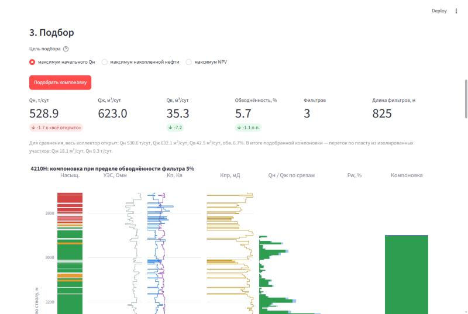
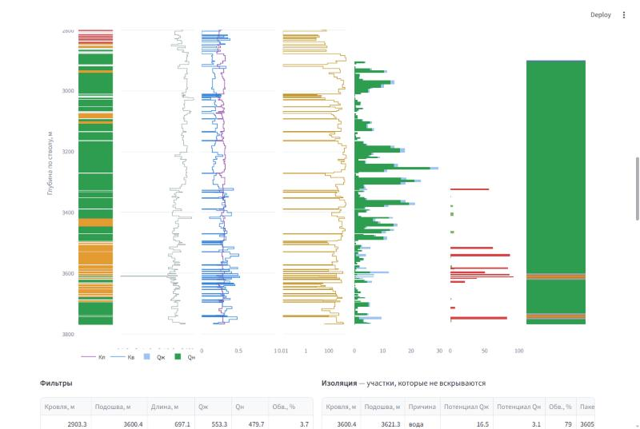
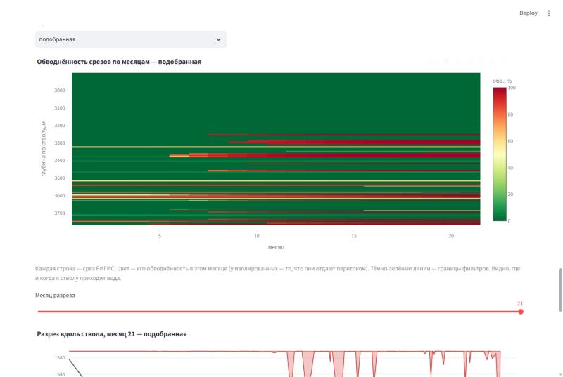
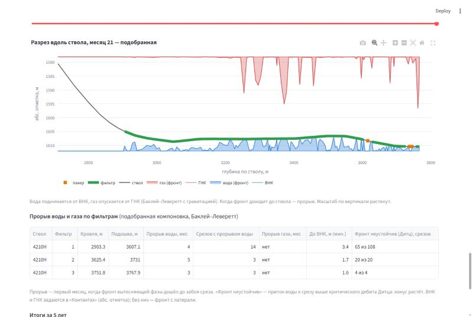
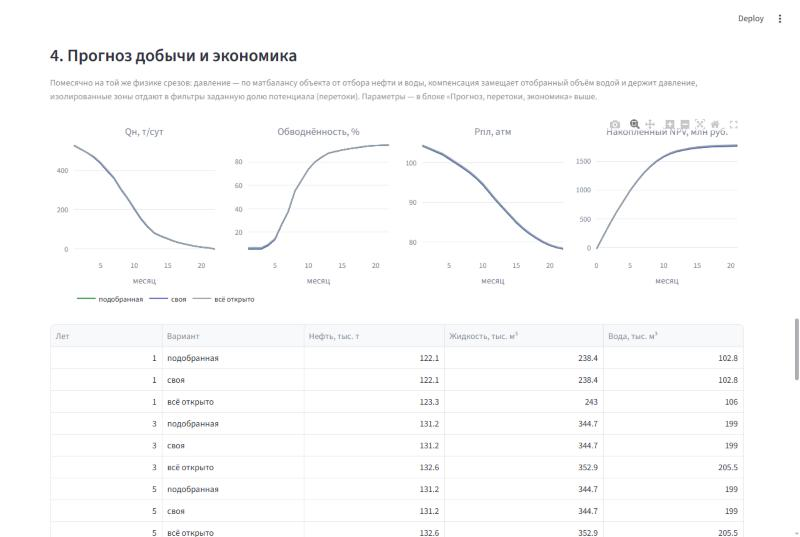
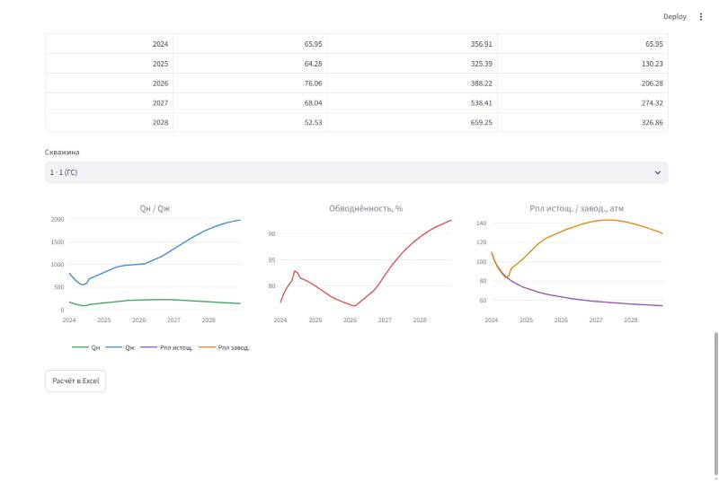

# retools — подбор компоновки ГС/МЗС по РИГИС и расчёт добычи

Инженерный инструмент для разработчика месторождений: загружаете РИГИС по
горизонтальной или многозабойной скважине — получаете дебиты нефти, жидкости,
воды и обводнённость по каждому интервалу и по стволу в целом, оптимальную
расстановку фильтров с изоляцией обводнённых участков пакерами, раскладку
хвостовика, прогноз добычи и экономику. Вторая часть — расчёт добычи по
рейтингу ГТМ (запасы, КИН, помесячный профиль с ППД).

Это перенос на Python Excel/VBA-расчётника **RE Tools** (листы «РИГИС»,
«PVT_MBE_Waterflood», «Нормировка Jd ГС по секциям», «Рейтинг ГТМ», «Расчёт
добычи», «ФА»). Формулы перенесены дословно и сверены с кэшем книги; подбор
фильтров вместо «Поиска решения» Excel — точный.

👉 **[Руководство пользователя](docs/USER_GUIDE.md)** — подготовка выгрузки, все настройки, как читать результат, ограничения модели.



## Что умеет

**Подбор компоновки по РИГИС** (вкладка «Подбор компоновки»)
- расчёт по срезам РИГИС: насыщенности, ОФП Бейкера (три фазы), обводнённость, газовый фактор, продуктивность секции ГС с учётом взаимовлияния секций, Qж, Qн, Qв, запасы;
- **автоматический подбор фильтров** на максимум начального Qн, накопленной нефти или NPV при ограничениях: предел обводнённости (на фильтр или на скважину), длины фильтров и промежутков, число фильтров, отступы от газа, ГНК, ВНК;
- **своя компоновка**: интервалы фильтров вручную, проверка правил, сравнение с подобранной и «всё открыто»;
- изоляция с расстановкой пакеров-эластомеров и раскладка хвостовика (фильтр / глухая труба / эластомер);
- перетоки по пласту вдоль ствола: сколько изолированный участок всё равно отдаёт к фильтрам (неколлектор — барьер);
- МЗС — совместный подбор по стволам;
- прогноз по месяцам: матбаланс, вытеснение Баклея–Леверетта по срезам, конусы воды от ВНК и газа от ГНК с гравитацией (прорыв по месяцам, предел Дитца), перетоки; стоимость компоновки и NPV;
- графики: обводнение ствола по месяцам (тепловая карта по срезам) и разрез вдоль ствола с конусами воды и газа на выбранный месяц;
- выгрузка в Excel и проект в JSON.

**Расчёт добычи по рейтингу ГТМ** (вкладка «Расчёт добычи»)
- продуктивность Get_J для ННС, ННС+ГРП, ГС, ГС+ГРП (МГРП вдоль/поперёк ствола), МЗС — нестационарный приток в прямоугольном пласте (решения в пространстве Лапласа, обращение Стефеста);
- рейтинг: запасы на истощение и вытеснение, прирост от ППД, потенциальный КИН, стартовые дебиты;
- помесячный расчёт истощаемой и заводняемой частей пласта, ППД с заданного месяца, ограничения по дебиту и обводнённости;
- объект разработки из параметров: матбаланс и все палетки заводнения строятся без книги.

| | |
|---|---|
|  |  |
|  |  |
|  |  |

## Быстрый старт

```bash
git clone https://github.com/Alex91132/retools.git
cd retools
pip install -e ".[ui,dev]"
streamlit run app.py
```

Откроется `http://localhost:8501`. Для пробы — встроенные примеры (обезличенная
скважина 4210H, синтетическая МЗС, рейтинг из 13 скважин) или файл
[`examples/rigis_4210H.xlsx`](examples/rigis_4210H.xlsx) — образец выгрузки РИГИС.

Тесты: `pytest` (часть тестов читает исходную книгу — укажите путь в
переменной `RETOOLS_BOOK`, без неё они пропускаются).

## Как считается

Модель — инженерный расчёт притока к стволу по формулам книги, а не
гидродинамический симулятор:

- каждый срез РИГИС считается независимо: водонасыщенность из РИГИС, газонасыщенность — из матбаланса объекта ниже давления насыщения, остаточные насыщенности — по петрофизическим регрессиям;
- ОФП нефти, воды и газа — по Бейкеру; обводнённость — по ОФП воды и нефти и вязкостям, газовый фактор — по ОФП газа и нефти;
- приток — продуктивность секции ГС (Get_J_obsolete, Бабу–Оде) с коэффициентом взаимовлияния секций по суммарной длине фильтров; депрессия — Вогель с учётом обводнённости;
- дебиты срезов складываются; подбор — динамическое программирование по срезам (точный оптимум при линейных ограничениях), взаимовлияние секций и перетоки уточняются итерациями;
- перетоки по пласту: изолированный срез отдаёт к фильтру долю ε = 1/(1 + J·R) по сопротивлению пути через соседние срезы;
- в прогнозе — фронт Баклея–Леверетта в объёме каждого среза, конусы от ВНК и ГНК с гравитацией.

Сетки пласта нет: фронт и конусы считаются аналитически по срезам.
Подробнее — в [руководстве](docs/USER_GUIDE.md#модель-что-учтено-и-чего-нет).

## Сверка с книгой

| Что | Совпадение |
|---|---|
| Лист «РИГИС», 24 столбца × 219 срезов | до 1e-9 |
| Палетки листа объекта (макрос FDP_Functions), 7 шт. | до 1e-12 |
| Get_J: ННС / ННС+ГРП / МЗС | 5e-12 / 3e-9 / 2e-6 |
| Get_J: ГС, ГС+ГРП | до 4e-5 (задача плохо обусловлена — книга сама «шумит» на 2e-6) |
| «Рейтинг ГТМ», 13 скважин | до 1e-9 |
| «Расчёт добычи», 72 строки × ~200 столбцов | до 1e-10 при той же продуктивности |

Подбор против «Поиска решения» книги на той же скважине: при пределе
обводнённости 0 % — 357,5 т/сут против 46,3, при 5 % — 532,8 против 329,3.

Найденные в книге ошибки и особенности — в [docs/PORTING.md](docs/PORTING.md#находки-в-книге).

## Структура

| Модуль | Что |
|---|---|
| `retools.rigis`, `rigis_physics`, `rigis_io` | расчёт по срезам (лист «РИГИС»), чтение выгрузки и проекта |
| `retools.completion` | подбор компоновки, своя компоновка, изоляция, хвостовик |
| `retools.forecast`, `lifetime`, `economics` | прогноз, подбор на накопленную нефть / NPV, стоимость и NPV |
| `retools.object_builder`, `waterflood`, `cpvt` | объект разработки: PVT, матбаланс, палетки |
| `retools.productivity` | Get_J — продуктивность по типам заканчивания |
| `retools.gtm_calc`, `gtm_io` | рейтинг ГТМ и расчёт добычи |
| `retools.ui_rigis`, `ui_gtm`, `app.py` | интерфейс Streamlit |

Статус переноса по модулям книги и подробности сверки — [docs/PORTING.md](docs/PORTING.md).

## Данные

Примеры обезличены: номера скважин, названия месторождения, района и объекта
заменены. Исходная книга RE Tools в репозиторий не входит.
