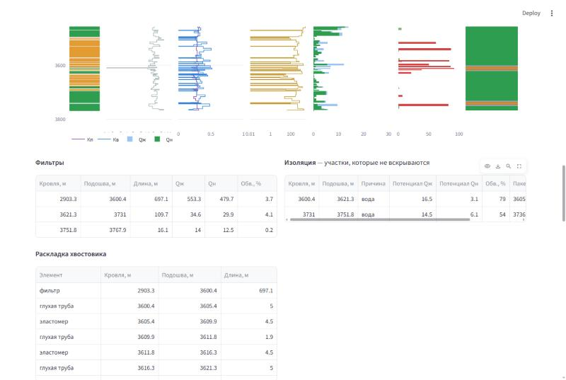
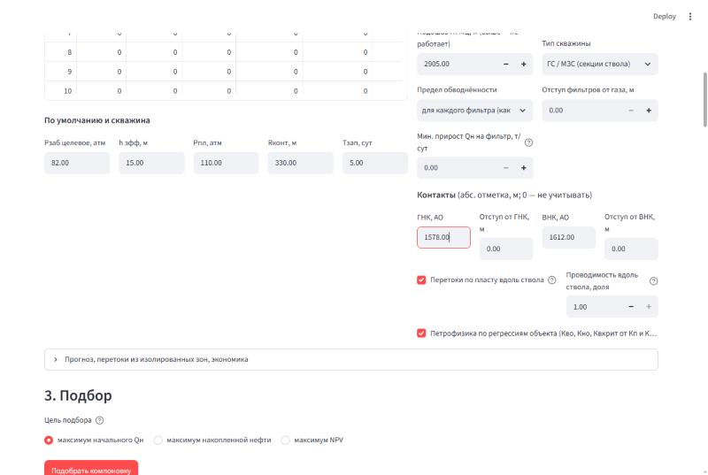
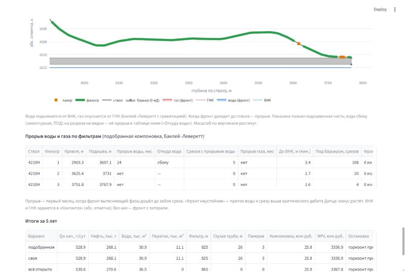
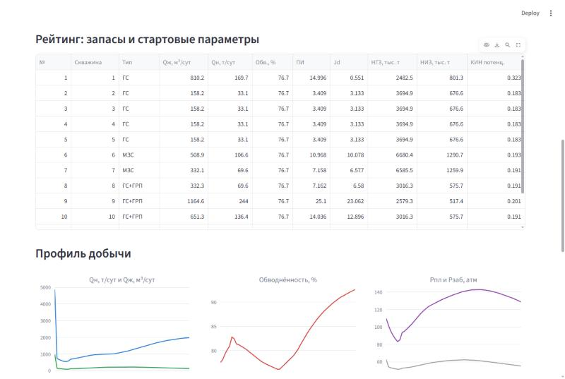

# Руководство пользователя

- [1. Установка и запуск](#1-установка-и-запуск)
- [2. Подготовка выгрузки РИГИС](#2-подготовка-выгрузки-ригис)
- [3. Подбор компоновки: пошагово](#3-подбор-компоновки-пошагово)
- [4. Своя компоновка — интервалы вручную](#4-своя-компоновка--интервалы-вручную)
- [5. Прогноз и экономика](#5-прогноз-и-экономика)
- [6. Расчёт добычи по рейтингу ГТМ](#6-расчёт-добычи-по-рейтингу-гтм)
- [Модель: что учтено и чего нет](#модель-что-учтено-и-чего-нет)
- [Частые вопросы](#частые-вопросы)

## 1. Установка и запуск

Нужен Python 3.10+.

```bash
git clone https://github.com/Alex91132/retools.git
cd retools
pip install -e ".[ui,dev]"
streamlit run app.py
```

Браузер откроет `http://localhost:8501`. Вкладки сверху:

| Вкладка | Для чего |
|---|---|
| Подбор компоновки (РИГИС) | дебиты по интервалам ствола, подбор фильтров и изоляции, своя компоновка, прогноз |
| Расчёт добычи (рейтинг ГТМ) | запасы, КИН и профиль добычи по списку скважин |
| PVT-свойства, Факторный анализ, Палетки | вспомогательные расчёты книги |

Файлы обрабатываются только у вас на компьютере. Книга RE Tools читается
как данные — макросы не выполняются.

## 2. Подготовка выгрузки РИГИС

Выгрузка — лист Excel, в котором одна строка — один срез (интервал) по стволу.
Строка заголовков может быть в любой из первых 80 строк; столбцы
распознаются по названиям (регистр, пробелы и «ё/е» не важны). Образец —
[`examples/rigis_4210H.xlsx`](../examples/rigis_4210H.xlsx).

| Что | Названия столбца, которые понимает программа | Обязателен |
|---|---|---|
| Скважина / ствол | «№ скважины», «скважина», «скв», «well» | для МЗС |
| Пласт | «пласт», «свита», «свита / пласт», «объект» | нет |
| Кровля, м (по стволу) | «кровля, ИГ», «кровля», «кровля, м», «top», «md top» | **да** |
| Подошва, м (по стволу) | «подошва, ИГ», «подошва», «подошва, м», «bottom» | **да** |
| Кровля / подошва, абс. отметка | «кровля, АО», «подошва, АО», «tvd top», «tvdss top» | для отступов от ГНК/ВНК |
| Мощность среза, м | «мощность», «толщина», «h» | **да** (если нет — подошва − кровля) |
| УЭС, Омм | «УЭС», «УЭС, Омм», «rt» | нет (для планшета) |
| Пористость общая | «Кп общ (PHIT)», «PHIT» | нет (иначе — Кп) |
| Пористость для расчёта, д. ед. | «Кп для расчёта», «Кп», «phie» | **да** |
| Глинистость | «Кгл», «vsh» | нет |
| Проницаемость, мД | «Кпр для расчёта», «Кпр», «perm» | **да** |
| Водонасыщенность, д. ед. | «Кв для расчёта», «Кв», «sw» | **да** |
| Нефтенасыщенность | «Кн», «so» | нет (иначе 1 − Кв) |
| Характер насыщения | «характер насыщения», «насыщение» | желательно |
| Коллектор | «коллектор», «коллектор *» | желательно |

Значения: Кп, Кв, Кн — в долях единицы; Кпр — в мД; глубины — в метрах.
Характер насыщения — «нефть», «нефть+вода», «вода», «газ», «разгазирование»
(газовые срезы не вскрываются и учитываются в отступе от газа). Коллектор —
«К» (работает) или «НК». Если столбца нет, коллектор — срез с Кпр > 0 и Кв < 1.

**МЗС.** Все стволы — в одной таблице, в столбце «скважина» у каждого ствола
своё название (например, «4210H» и «4210H/2»). Программа разделит срезы по
стволам и подберёт компоновку совместно.

## 3. Подбор компоновки: пошагово

### 3.1. Данные

В разделе **«1. Данные»** выберите источник:

- **Выгрузка РИГИС (Excel)** — ваша таблица срезов. Рядом можно загрузить объект разработки (файл проекта .json или книгу RE Tools); без него берутся объект и палетки примера;
- **Книга RE Tools (.xlsm)** — срезы и настройки с листа «РИГИС» книги;
- **Файл проекта (.json)** — сохранённый ранее проект (кнопка внизу страницы);
- **Примеры** — обезличенная скважина 4210H и синтетическая МЗС из двух стволов.


Блок **«Объект разработки и палетки секций ГС»** — свойства пласта и флюида:
начальное давление, глубина, температура, PVT (Rsb, Pb, Bob, μob, плотности),
ОФП Бейкера (остаточные насыщенности, концевые точки, степени), две единицы
потока для палеток заводнения. Кнопка «Построить объект и палетки из
параметров» заново решает матбаланс и строит палетки — книга для этого не нужна.

### 3.2. Настройки

**Зоны пласта** — параметры по интервалам глубины (по стволу). Пустые
значения — «по умолчанию» ниже.

| Столбец | Влияет на |
|---|---|
| Кровля, Подошва | границы зоны |
| h эфф, м | эффективная мощность для продуктивности секции и запасов |
| Рпл нач, атм | пластовое давление зоны — депрессия и дебит |
| Доля заводн. | доля запасов на вытеснение (НИЗ от ППД) |
| Rконт, м | радиус контура питания — продуктивность и запасы |
| ППД/доб | соотношение нагнетательных и добывающих — прирост запасов от ППД |

**По умолчанию и скважина**: целевое Рзаб, h эфф, Рпл, Rконт, Тзап (время
выхода на псевдоустановившийся режим, сут — для продуктивности).

**Правила компоновки**

| Настройка | Смысл |
|---|---|
| Предел обводнённости, % | максимальная обводнённость; «для каждого фильтра» (как в книге) или «для скважины в целом» |
| Макс. число фильтров | не больше стольких фильтров на скважину |
| Мин. длина фильтра, м | фильтр короче не ставится |
| Мин. расстояние между фильтрами, м | в промежутке должны поместиться глухая труба и пакеры |
| Длина эластомера, отступ от фильтра, м | размер пакера и где он ставится |
| Подошва ПГМЦ, м | выше этой глубины ствол не работает |
| Тип скважины | ГС/МЗС (секции ствола) или вертикальная/наклонная (перфорация) |
| Отступ фильтров от газа, м | фильтр не ближе к газонасыщенным срезам (по стволу) |
| Мин. прирост Qн на фильтр, т/сут | фильтр ставится, только если добавляет больше |
| Контакты: ГНК, ВНК (АО) и отступы | срезы ближе к контакту по вертикали не вскрываются; в прогнозе — источник конусов воды и газа; нужны столбцы АО |
| Перетоки по пласту вдоль ствола | изолированный срез отдаёт к ближайшему фильтру долю своего потенциала через соседние срезы пласта; неколлектор — барьер |
| Проводимость вдоль ствола, доля | калибровка перетоков: 1 — однородный пласт, меньше — есть непроницаемые прослои, 0 — перетоков нет |
| Петрофизика по регрессиям | остаточные насыщенности по Кп и Кпр (регрессии объекта) или постоянные |

### 3.3. Результат подбора

В разделе **«3. Подбор»** выберите цель:

- **максимум начального Qн** — как в книге;
- **максимум накопленной нефти** за горизонт прогноза — учитывает, что обводнённые срезы со временем сажают давление и обводняют скважину;
- **максимум NPV** — то же в деньгах, со стоимостью компоновки.


Сверху — итог: **Qн** (т/сут), **Qж** (м³/сут), **Qв** (м³/сут), **обводнённость**,
число и длина фильтров; стрелки — разница с вариантом «весь коллектор открыт».

Если включены перетоки по пласту, в итог входит то, что изолированные участки
отдают к фильтрам через пласт (строка под показателями), а в таблице
«Изоляция» — доля перетока по каждому участку. Без барьеров (неколлектора)
между участком и фильтром доля близка к 100 %: в однородном пласте пакер
отсекает затрубье, но не пласт. Поэтому при перетоках подбор сам двигает
границы изоляции так, чтобы между ней и фильтром оказался неколлектор.

**Планшет** по глубине ствола: насыщение (зелёный — нефть, светло-зелёный —
нефть+вода, синий — вода, красный — газ, оранжевый — разгазирование; серый —
неколлектор), УЭС, Кп и Кв, Кпр, Qж и Qн по срезам, обводнённость среза Fw
(красным — выше предела), справа — компоновка: фильтры (зелёный), пакеры
(оранжевый), глухая труба (серый).


Под планшетом — таблицы **Фильтры** (интервалы и дебиты), **Изоляция** (что
не вскрывается, почему — «вода», «газ», «неколлектор», «отступ от ГНК»… — и
какой потенциал теряется, где стоят пакеры) и **Раскладка хвостовика** по
метрам. График «Qн от предела обводнённости» показывает, сколько нефти даёт
ослабление предела.



## 4. Своя компоновка — интервалы вручную

Раздел **«Своя компоновка»** — таблица интервалов фильтров (кровля и подошва,
м по стволу), сначала заполнена подобранной компоновкой. Меняйте значения,
добавляйте и удаляйте строки — расчёт обновляется сразу:

- фильтр вскрывает срезы РИГИС, середина которых попадает в интервал, поэтому границы фильтра — по границам срезов;
- изоляция, пакеры и хвостовик строятся по тем же правилам, что у подбора;
- таблица сравнивает **свою**, **подобранную** и **«всё открыто»**: Qн, Qж, Qв, обводнённость, фильтры, пакеры;
- предупреждения: короткий фильтр, промежуток, куда не помещаются пакеры, вскрытие газа или зоны у контакта, пересечение интервалов (они объединяются);
- своя компоновка попадает в прогноз и выгружается отдельной кнопкой.

Кнопка «Сбросить к подобранной компоновке» возвращает исходные интервалы. Для
МЗС — таблица на каждый ствол.


## 5. Прогноз и экономика

Параметры — в блоке **«Прогноз, перетоки из изолированных зон, экономика»**
(перед подбором): горизонт, компенсация отбора (0 — истощение, 1 — давление
держится), коэффициент эксплуатации, минимальный Qн и предельная
обводнённость для остановки, Рзаб на период прогноза; модель вытеснения; доля
потенциала, которую изолированные зоны отдают в фильтры через пакеры
(негерметичность), и её рост; цены и ставка.

**Модель вытеснения**

- **Баклей–Леверетт** (по умолчанию). Вода приходит в объём каждого среза фронтом: до прорыва срез работает со своей начальной обводнённостью, после — насыщенность у забоя растёт по Велджу. Если в «Контактах» задан **ВНК**, вода поднимается снизу через столб пласта между ВНК и стволом, гравитация тормозит фронт — это конус: чем ближе ВНК и выше дебит, тем раньше прорыв. Если задан **ГНК** и у объекта есть газовая шапка (m > 0), газ опускается сверху (доля отбора, не компенсированная водой), после прорыва у забоя растут газонасыщенность и газовый фактор. Без контактов — фронт приходит с латерали.
- **Упрощённое** (как раньше): водонасыщенность среза растёт сразу пропорционально отбору — обводнение без задержки, оценка «с запасом».

Контакты задаются в настройках (абс. отметка; 0 — не учитывать). ГНК ставьте
выше ствола: срезы выше ГНК считаются газовой шапкой и не вскрываются.

**Откуда приходит вода** — переключатель «Источник воды» в блоке прогноза:

- **снизу** — подошвенная вода поднимается конусом от ВНК (нужен ВНК);
- **сбоку** — законтурная вода или нагнетательные скважины ППД: фронт с латерали;
- **смешанный** — компенсация делится по доле подошвенной воды; оба фронта считаются одновременно, у забоя — тот, что пришёл раньше.

Какой механизм работает в пласте, программа сама не знает — это решение
инженера по геологии и истории добычи соседних скважин. Конус обычно даёт
быстрый рост обводнённости в первые месяцы, фронт сбоку — безводный период и
затем S-образный рост. Без ВНК вода всегда приходит сбоку. В таблице прорывов
столбец «Откуда вода» показывает, какой фронт дошёл первым.

**Барьер** — галочка рядом с «Контактами»: прослой глины или плотняка между
стволом и ВНК (или между ГНК и стволом) с отметкой кровли, толщиной и
проницаемостью (0 — непроницаемый). Через барьер вода поднимается не больше
потока по Дарси при депрессии среза, остальная обходит его и приходит сбоку.
Непроницаемый барьер полностью перекрывает конус. На разрезе барьер — серая
полоса. По выгрузке РИГИС вдоль ствола барьер не виден: его берут по пилотному
стволу или соседним вертикальным скважинам.



**Обводнение ствола во времени** — тепловая карта: по горизонтали месяцы, по
вертикали срезы ствола, цвет — обводнённость среза. Видно, к каким интервалам
и когда приходит вода; линии — границы фильтров. Вариант (подобранная, своя,
«всё открыто») выбирается сверху.


**Разрез вдоль ствола** (при заданных ВНК или ГНК): траектория по абсолютной
отметке, фильтры и пакеры, вода, поднявшаяся от ВНК, и газ, опустившийся от
ГНК, на выбранный ползунком месяц. Где фронт касается ствола — прорыв.
Масштаб по вертикали растянут: десятки метров по высоте против километра по стволу.


Таблица **«Прорыв воды и газа по фильтрам»**: месяц первого прорыва, сколько
срезов фильтра прорвались, минимальное расстояние до ВНК и число срезов с
неустойчивым фронтом — где приток воды выше критического дебита Дитца и конус
растёт.



Раздел **«4. Прогноз добычи и экономика»** сравнивает варианты (подобранная,
своя, «всё открыто») по Qн, обводнённости, давлению и накопленному NPV, даёт
накопленные нефть, жидкость и воду за 1, 3 и N лет и итоги со стоимостью
компоновки.


**Выгрузка** (раздел 5): компоновка и расчёт в Excel (компоновка, изоляция,
срезы, кривая, прогноз, экономика), своя компоновка в Excel, проект в JSON —
его можно загрузить потом как источник.

## 6. Расчёт добычи по рейтингу ГТМ

Вкладка **«Расчёт добычи (рейтинг ГТМ)»** — аналог листов «Рейтинг ГТМ» и
«Расчёт добычи» книги.

1. Источник: книга RE Tools (читаются лист «Рейтинг ГТМ» и листы объектов из столбца «Лист объекта») или пример из 13 скважин.
2. Таблица **Скважины** редактируется: свойства пласта (h, Кп, k, Kv/Kh, Sw, Рпл, доля заводняемых толщин), заканчивание (длины ГС и боковых стволов, число трещин, Xf, раскрытие и проницаемость проппанта, ориентация «Вдоль»/«Поперёк»), Rконт, Rскв, скин, Рзаб, ППД (начало, ППД/доб, Рбуф, макс. приёмистость и компенсация), остановка (мин. Qн, предельная обводнённость), длительность.
3. Тип заканчивания определяется сам: есть боковые стволы — МЗС; L ГС > 0 — ГС или ГС+ГРП; иначе ННС или ННС+ГРП.
4. **Рассчитать** — рейтинг (Qж, Qн, обводнённость, продуктивность, Jd, НГЗ, НИЗ, потенциальный КИН) и профиль по месяцам: сумма по скважинам и по выбранной скважине.




Галочки: «Объект пересчитать из параметров» — матбаланс и палетки заново
(иначе — таблицы листа объекта из книги); «CJ как в книге для строк 8+» —
вариант книги, в котором прирост запасов от ППД учитывается дважды (по
умолчанию — правильная формула строки 7).

Пласт делится на две части. **Истощаемая** (1 − доля заводняемых толщин):
давление падает по матбалансу объекта. **Заводняемая**: с месяца начала ППД
закачка поддерживает давление, Sw растёт с отбором, ОФП — по палеткам смеси.
При скачках давления шаг расчёта — 10 суток.

## Модель: что учтено и чего нет

**Учтено**

- три насыщенности в каждом срезе: вода — из РИГИС, газ — из матбаланса объекта ниже давления насыщения, нефть — остаток;
- трёхфазные ОФП Бейкера; остаточные насыщенности — по петрофизическим регрессиям объекта (или постоянные);
- обводнённость Fw = f(Krw, Kro, μw, μo, Bw, Bo); газ влияет через Kro; газовый фактор = Rs + Krg/Kro · μo·Bo / (μg·Bg);
- продуктивность секции ГС по Бабу–Оде с коэффициентом взаимовлияния секций (палетки Jd по суммарной длине фильтров и длине секции);
- депрессия по Вогелю с учётом обводнённости и давления насыщения;
- перетоки по пласту вдоль ствола: доля потенциала изолированного среза ε = 1/(1 + J·R), R — сопротивление пути к ближайшему фильтру через соседние срезы (Дарси, вертикальная составляющая пути — с учётом kv/kh, неколлектор — барьер);
- в прогнозе — вытеснение Баклея–Леверетта в объёме каждого среза (фронт, прорыв, насыщенность у забоя по Велджу), конусы воды от ВНК и газа от ГНК с гравитацией, предел устойчивости фронта по Дитцу;
- Qн = Qж · ρн · (1 − Fw), Qв = Qж − Qн / ρн;
- в прогнозе — давление по матбалансу от отбора нефти и воды, замещение отобранного объёма водой при компенсации, перетоки через пакеры.

**Не учтено**

- сетка пласта: фронт и конусы считаются аналитически в объёме каждого среза, а не на сетке — это не гидродинамический симулятор;
- взаимное влияние срезов по давлению (кроме коэффициента секций и перетоков из изолированных участков); давление общее по матбалансу;
- неоднородность пласта выше и ниже ствола: свойства столба до ВНК и ГНК — как у среза;
- потери давления по стволу;
- в прогнозе — неоднородность обводнения по площади (дренируемый объём — «стадион» вокруг фильтров).

## Частые вопросы

**Почему дебит фильтра не равен сумме по таблице срезов?** Коэффициент
взаимовлияния секций зависит от суммарной длины фильтров, поэтому у разных
компоновок одни и те же срезы дают разный дебит.

**Почему подобранная компоновка не открывает срез с большим Qн?** Он нарушает
правило: обводнённость фильтра выше предела, близко газ или контакт, слишком
короткий фильтр или промежуток. Причина видна в таблице «Изоляция».

**Можно ли считать вертикальную скважину?** Да, «Тип скважины —
вертикальная/наклонная»: срезы считаются как пласты, вскрытые перфорацией
(расширение, в книге этого нет).

**Где точность ниже книги?** Продуктивность Get_J для ГС и МГРП численно
плохо обусловлена — расхождение с книгой до 4e-5, сама книга меняет результат
на 2e-6 от последних знаков входных данных. Для инженерных расчётов это
незаметно.
